<picture><source media="(prefers-color-scheme: dark)" srcset="https://raw.githubusercontent.com/rishibhaskar777/rishibhaskar777/main/r2-hero-dark.svg"></picture>

  <b>Live:</b> <a href="https://dueline-azure.vercel.app">Dueline</a> · <a href="https://neevcheck-up.vercel.app">NeevCheck</a>
  &nbsp;&nbsp;|&nbsp;&nbsp;
  <a href="https://www.linkedin.com/in/rishi-bhaskar-2b0115377">LinkedIn</a> · <a href="mailto:rishibhaskar254@gmail.com">Email</a>

## Shipped this month

<a href="https://github.com/rishibhaskar777/dueline"><picture><source media="(prefers-color-scheme: dark)" srcset="https://raw.githubusercontent.com/rishibhaskar777/rishibhaskar777/main/r2-show-dueline-dark.svg"></picture></a>

  
  

<a href="https://dueline-azure.vercel.app">Open the live demo</a> · <a href="https://github.com/rishibhaskar777/dueline">Read the code</a>

<a href="https://github.com/Nitinmittal373/NeevCheck"><picture><source media="(prefers-color-scheme: dark)" srcset="https://raw.githubusercontent.com/rishibhaskar777/rishibhaskar777/main/r2-show-neevcheck-dark.svg"></picture></a>

  
  

<a href="https://neevcheck-up.vercel.app">Open the live demo</a> · <a href="https://github.com/Nitinmittal373/NeevCheck">Read the code</a>

## Also built

  <a href="https://github.com/rishibhaskar777/whichai"><picture><source media="(prefers-color-scheme: dark)" srcset="https://raw.githubusercontent.com/rishibhaskar777/rishibhaskar777/main/r2-tile-whichai-dark.svg"></picture></a>
  <a href="https://github.com/rishibhaskar777/PackComply"><picture><source media="(prefers-color-scheme: dark)" srcset="https://raw.githubusercontent.com/rishibhaskar777/rishibhaskar777/main/r2-tile-packcomply-dark.svg"></picture></a>
  <a href="https://github.com/Nitinmittal373/HACKATHON_DTU_2026"><picture><source media="(prefers-color-scheme: dark)" srcset="https://raw.githubusercontent.com/rishibhaskar777/rishibhaskar777/main/r2-tile-shastra-dark.svg"></picture></a>
  <a href="https://github.com/begoneeraj/Life-rpg"><picture><source media="(prefers-color-scheme: dark)" srcset="https://raw.githubusercontent.com/rishibhaskar777/rishibhaskar777/main/r2-tile-liferpg-dark.svg"></picture></a>

## How I build

<picture><source media="(prefers-color-scheme: dark)" srcset="https://raw.githubusercontent.com/rishibhaskar777/rishibhaskar777/main/r2-tools-dark.svg"></picture>

## Lately on GitHub

<!--START_SECTION:activity-->
1. 🎉 Merged PR [#50](https://github.com/rishibhaskar777/dueline/pull/50) in [rishibhaskar777/dueline](https://github.com/rishibhaskar777/dueline)
2. 💪 Opened PR [#50](https://github.com/rishibhaskar777/dueline/pull/50) in [rishibhaskar777/dueline](https://github.com/rishibhaskar777/dueline)
3. 🎉 Merged PR [#49](https://github.com/rishibhaskar777/dueline/pull/49) in [rishibhaskar777/dueline](https://github.com/rishibhaskar777/dueline)
4. 💪 Opened PR [#49](https://github.com/rishibhaskar777/dueline/pull/49) in [rishibhaskar777/dueline](https://github.com/rishibhaskar777/dueline)
5. 🎉 Merged PR [#46](https://github.com/rishibhaskar777/dueline/pull/46) in [rishibhaskar777/dueline](https://github.com/rishibhaskar777/dueline)
<!--END_SECTION:activity-->

 

Open to frontend and UI/UX roles and collaborations · <a href="mailto:rishibhaskar254@gmail.com">rishibhaskar254@gmail.com</a>

