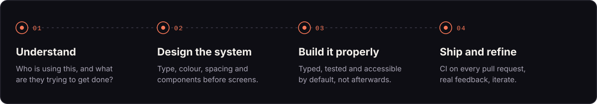
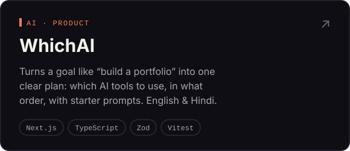
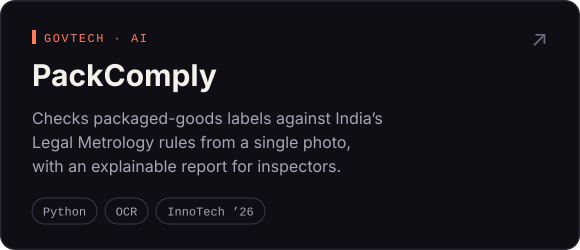
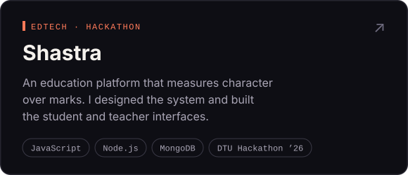
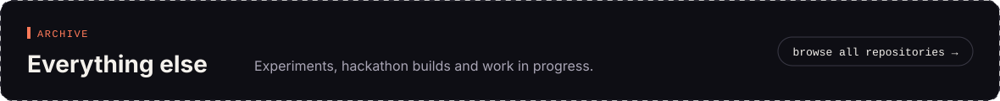

  

  
  
  

## About

I'm a CSE student at KIET who cares most about the part of software people actually touch.
I start with how something should **feel** (the layout, the spacing, the moment a button responds)
and then build whatever is needed underneath to make it real.

Frontend and UI/UX are home. Full-stack is where I'm heading, one layer deeper with every project.

## How I work

## Selected work

  
  
  
  

## Toolkit

  
  
  
  
  
  
  
  
  
  
  
  
  

## Lately on GitHub

<!--START_SECTION:activity-->
1. 💪 Opened PR [#6](https://github.com/rishibhaskar777/PackComply/pull/6) in [rishibhaskar777/PackComply](https://github.com/rishibhaskar777/PackComply)
2. 🎉 Merged PR [#5](https://github.com/rishibhaskar777/PackComply/pull/5) in [rishibhaskar777/PackComply](https://github.com/rishibhaskar777/PackComply)
3. 💪 Opened PR [#5](https://github.com/rishibhaskar777/PackComply/pull/5) in [rishibhaskar777/PackComply](https://github.com/rishibhaskar777/PackComply)
4. 🎉 Merged PR [#19](https://github.com/rishibhaskar777/whichai/pull/19) in [rishibhaskar777/whichai](https://github.com/rishibhaskar777/whichai)
5. 💪 Opened PR [#19](https://github.com/rishibhaskar777/whichai/pull/19) in [rishibhaskar777/whichai](https://github.com/rishibhaskar777/whichai)
<!--END_SECTION:activity-->

 

  Open to internships and collaborations · <a href="mailto:rishibhaskar254@gmail.com">rishibhaskar254@gmail.com</a>

